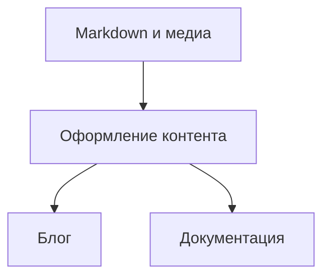
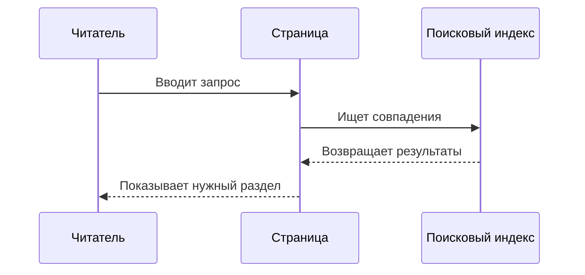

Хорошая техническая статья помогает разобраться в сложном, не отвлекая от мысли. Здесь собраны элементы, из которых складываются статьи в этом блоге: от обычного абзаца до формул, диаграмм и видео.

Это живая страница-образец. Её можно читать, увеличивать изображения, запускать видео и переходить по ссылкам на заголовки.

## Текст и типографика

Русский и English встречаются в одном абзаце: **типизация**, *type inference*, `Result[T]`. Шрифты должны одинаково уверенно показывать кириллицу, латиницу, цифры 0123456789 и знаки — «кавычки», (скобки), стрелки → и математические символы ±.

<p lang="en">A useful abstraction makes the important things visible. Good documentation does the same: it gives an idea enough room to breathe, then connects it to a concrete example.</p>

Можно выделить **главную мысль**, сделать *небольшое замечание*, совместить ***оба начертания*** или показать ~~устаревший вариант~~. Ссылка на [блог](/) остаётся частью предложения, а сноска позволяет убрать подробность из основного текста.[^reading]

### Заголовок третьего уровня

Заголовки организуют материал. Ссылка слева от заголовка ведёт прямо к этому месту — удобно, когда хочется поделиться конкретным объяснением.

#### Заголовок четвёртого уровня

Небольшой подраздел подходит для уточнения внутри одной темы. После него текст возвращается к привычному ритму.

##### Заголовок пятого уровня

Этот уровень оставлен в образце для проверки глубоко вложенной структуры.

###### Заголовок шестого уровня

Самый глубокий заголовок тоже должен оставаться различимым и иметь собственный якорь.

## Списки и последовательности

Перед тем как описывать решение, полезно собрать контекст:

- Какую задачу решает система.
- Какие ограничения влияют на реализацию.
  - Время ответа.
  - Объём памяти.
  - Совместимость с существующими данными.
- По каким признакам мы поймём, что решение работает.

Порядок действий можно записать отдельно:

1. Воспроизвести поведение на небольшом примере.
2. Сформулировать ожидаемый результат.
3. Проверить решение и записать вывод.

А состояние работы — обычным Markdown-списком:

- [x] Собрать пример.
- [x] Добавить пояснение.
- [ ] Сверить результат с исходной гипотезой.

## Цитаты и примечания

> Хороший пример позволяет увидеть закономерность раньше, чем её формальное определение.
>
> Для этого иногда достаточно нескольких строк кода и одного точного вопроса.

> [!NOTE]
> Примечание добавляет контекст, который полезен при первом знакомстве с темой.

> [!TIP]
> Начните с минимального примера. Так проще отделить основную идею от деталей реализации.

> [!IMPORTANT] Важная договорённость
> Результат функции должен зависеть от явно переданных аргументов. Обратите внимание на `config` и значения по умолчанию.

> [!WARNING]
> Повторный запуск операции может изменить состояние. Проверьте, является ли она идемпотентной.

> [!CAUTION]
> Удаление данных необратимо без резервной копии. Сначала убедитесь, что выбрана правильная среда.

## Код

Короткое выражение `cache.get(key)` можно встроить прямо в текст. Для законченного примера нужен отдельный блок.

### Python

```python
from collections.abc import Iterable
from dataclasses import dataclass


@dataclass(frozen=True)
class Article:
    title: str
    minutes: int


def reading_time(articles: Iterable[Article]) -> int:
    return sum(article.minutes for article in articles)


articles = [Article("Типы и смыслы", 8), Article("Small abstractions", 5)]
print(f"Время чтения: {reading_time(articles)} минут")
```

### Shell и конфигурация

```sh
hugo server --buildDrafts
curl --fail http://localhost:1313/
```

```toml
[markup.highlight]
style = "github"
noClasses = false
```

### Обычный текст и длинные строки

У блока без указанного языка сохраняются отступы и моноширинный шрифт. Длинная строка прокручивается внутри блока.

```
content/
├── articles/
│   ├── types.ru.md
│   └── types.en.md
└── docs/
    └── getting-started.md

GET /api/articles?language=ru&topic=programming&sort=published_at&direction=descending&include=title,description,reading_time,translations
```

## Таблицы

Таблица помогает сравнить свойства, которые неудобно перечислять в нескольких похожих абзацах.

| Элемент | Для чего нужен | Пример |
|:--------|:---------------|-------:|
| Абзац | Объяснить одну мысль | 3 предложения |
| Блок кода | Показать реализацию | 12 строк |
| Диаграмма | Сделать связи видимыми | 4 узла |
| Примечание | Добавить контекст | 1 уточнение |

## Диаграммы Mermaid

Диаграмма описывается текстом рядом с остальным материалом. Здесь один источник контента используется в двух разных оболочках.



Другой вид диаграммы показывает порядок взаимодействий:



## Формулы

Математика может быть частью предложения: $a^2 + b^2 = c^2$. Более длинное выражение получает отдельную строку:

$$
\operatorname{softmax}(z_i) = \frac{e^{z_i}}{\sum_{j=1}^{n} e^{z_j}}
$$

Ещё один пример — расстояние между двумя векторами:

$$
d(\mathbf{x}, \mathbf{y}) = \sqrt{\sum_{i=1}^{n}(x_i-y_i)^2}
$$

## Изображения и увеличение

Иллюстрация из материалов блога. Нажмите на неё, чтобы рассмотреть детали, и нажмите Escape, чтобы вернуться к чтению.


### Ограниченная ширина

Та же иллюстрация с заданной шириной через существующий синтаксис блога:


### Анимация

GIF тоже остаётся частью статьи:


## Видео

Запись из статьи о демонстрации экрана. У видео доступны стандартные элементы управления: воспроизведение, перемотка и полный экран.


## Иконки Nerd Font

Иконки могут соседствовать с обычным текстом и обозначать знакомые инструменты:

<ul class="demo-icons">
  <li><span aria-hidden="true">&#xf09b;</span> GitHub</li>
  <li><span aria-hidden="true">&#xf120;</span> Терминал</li>
  <li><span aria-hidden="true">&#xf013;</span> Настройки</li>
  <li><span aria-hidden="true">&#xf15c;</span> Документ</li>
</ul>

## Дополнительные детали

<details>
  <summary>Почему все примеры собраны на одной странице?</summary>
  <p>Так можно сравнить оформление до и после выделения общего модуля: проверить шрифты, интервалы, поведение медиа и отображение на узком экране.</p>
</details>

---

На этом образец заканчивается. Вернуться к нужному элементу можно через оглавление или по [ссылке на начало страницы](#demo-title).

[^reading]: Сноски тоже входят в образец: проверяем их размер, ссылки и возврат к месту упоминания.
